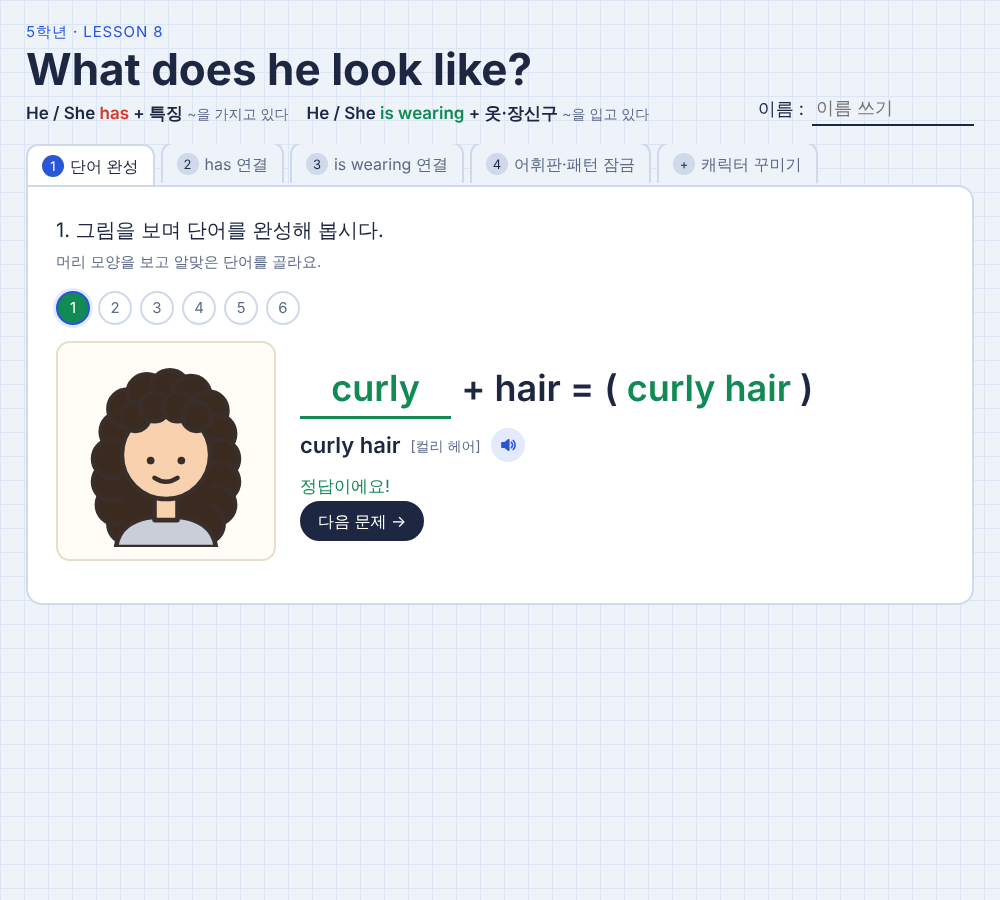
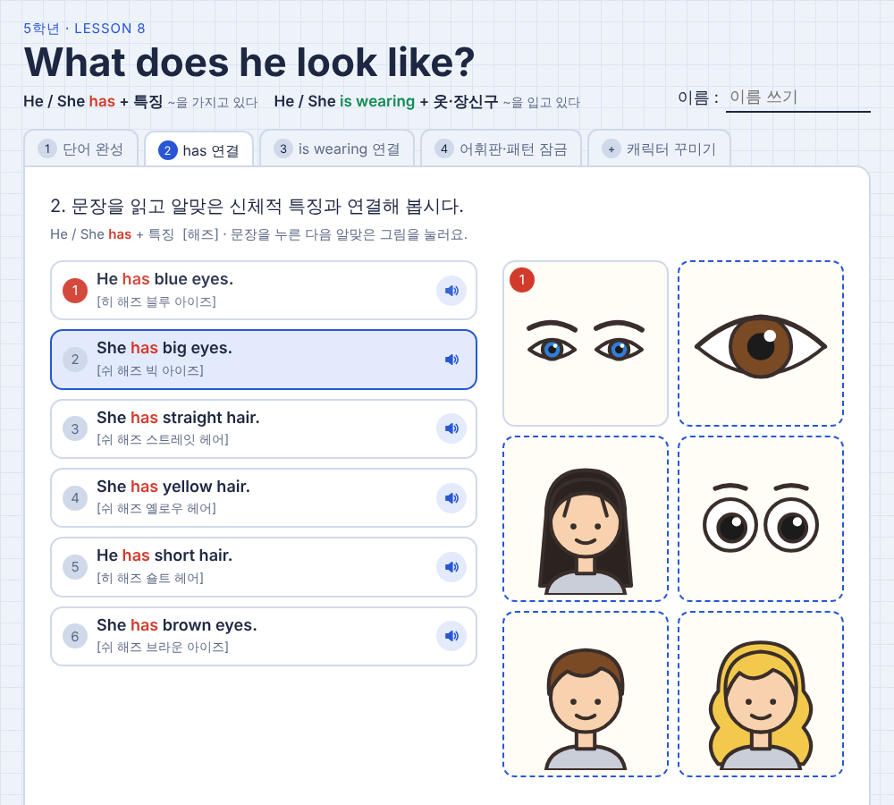
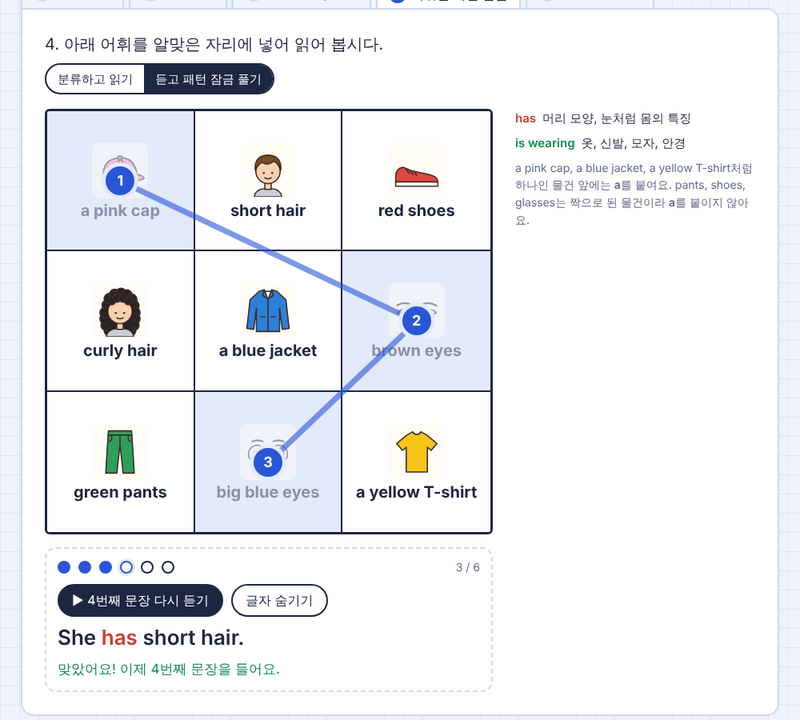
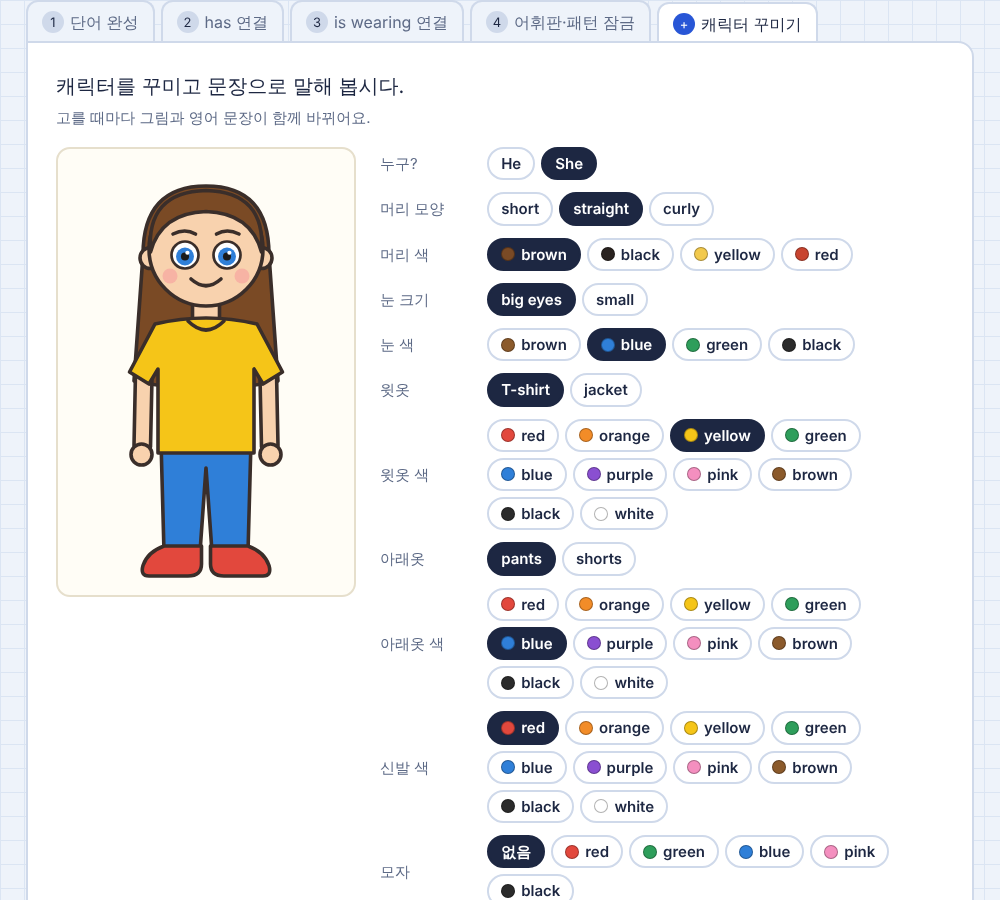
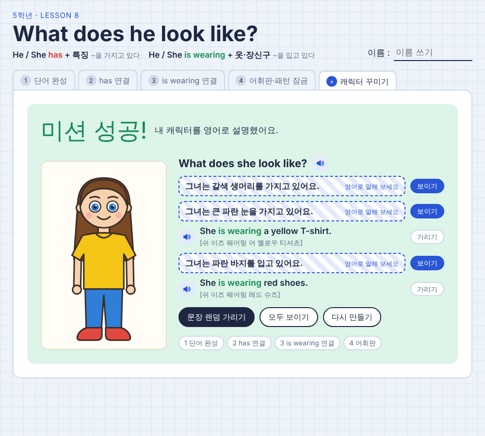

# What does he look like? — 초등 5학년 영어 8단원 웹 활동

5학년 영어 8단원 미니북(「What does he look like?」)을 그대로 옮겨 만든 웹 활동입니다.
설치 없이 `index.html` 파일 하나로 실행되며, 컴퓨터·태블릿·휴대폰 브라우저에서 모두 사용할 수 있습니다.

| 핵심 표현 | 뜻 | 쓰임 |
|---|---|---|
| He / She **has** + 특징 | ~을 가지고 있다 | 머리 모양, 머리 색, 눈 |
| He / She **is wearing** + 옷·장신구 | ~을 입고 있다 | 옷, 신발, 모자, 안경 |



---

## 1. 수업자료 설명

### 1-1. 개요

- **대상**: 초등학교 5학년 (영어 8단원)
- **원자료**: 4쪽 분량 미니북 학습지 (단어 완성 → has 문장 연결 → is wearing 문장 연결 → 어휘판 읽기)
- **활용 형태**: 학생 1인 1기기 개별 활동, 짝 활동, 교사 화면 공유 전체 활동
- **소요 시간**: 활동 전체 약 30~40분 (활동별로 따로 써도 됨)

### 1-2. 활동 구성

미니북의 활동 번호와 순서를 그대로 따랐고, 마지막에 표현을 직접 써 보는 꾸미기 활동을 더했습니다.

| 탭 | 미니북 대응 | 학생이 하는 일 | 확인 방식 |
|---|---|---|---|
| **1 단어 완성** | 1쪽 | 그림을 보고 `curly / straight`를 고르거나 팔레트에서 색깔을 골라 `( ) pants`, `( ) eyes` 같은 빈칸 완성 (6문항) | 정답이면 단어와 발음을 보여 주고 읽어 줌, 오답이면 그림이 흔들림 |
| **2 has 연결** | 2쪽 | `He has blue eyes.` 등 6문장을 읽고 머리·눈 그림과 연결 | 문장 → 그림 순서로 눌러 연결, 맞으면 번호 배지 |
| **3 is wearing 연결** | 3쪽 | `She is wearing red shoes.` 등 7문장을 옷·신발·장신구 그림과 연결 | 위와 같음 |
| **4 어휘판 · 패턴 잠금** | 4쪽 | **분류하고 읽기**: 3×3 어휘판의 낱말을 `has` / `is wearing` 중 알맞은 곳에 넣고 완성 문장 읽기<br>**듣고 패턴 잠금 풀기**: 들려주는 문장 6개를 순서대로 찾아 휴대폰 잠금 화면처럼 선을 이음 | 6개를 바른 순서로 찾으면 "잠금 해제!", 틀린 횟수 표시 |
| **+ 캐릭터 꾸미기** | 심화 | 머리 모양·색, 눈, 옷, 신발, 모자, 안경을 골라 캐릭터를 꾸밈 → 영어 문장이 자동으로 만들어짐 → **[완성]** | 미션 성공 화면에서 문장마다 **[가리기]**: 한글 뜻만 보고 영어로 말해 본 뒤 **[보이기]**로 확인 |




### 1-3. 공통 기능

- **듣기**: 모든 문장 옆 스피커 버튼을 누르면 영어 원어 발음으로 읽어 줍니다 (브라우저 내장 음성 사용).
- **한글 발음 표기**: 미니북과 같은 방식으로 `[쉬 해즈 브라운 아이즈]` 형태의 발음을 함께 보여 줍니다.
- **색 구분**: 미니북과 똑같이 `has`는 빨간색, `is wearing`은 초록색으로 표시해 두 표현을 눈으로 구분하게 했습니다.
- **이름 쓰기**: 상단 이름 칸에 쓴 이름은 그 기기에 저장되고, 미션 성공 화면에 함께 나옵니다.
- **완료 표시**: 끝낸 활동 탭에는 ★가 붙습니다.
- **다크 모드**: 기기 설정이 어두운 화면이면 자동으로 어두운 색으로 바뀝니다.




---

## 2. 기대효과 및 실제 수업 예상 반응

### 2-1. 기대효과

1. **두 표현의 구분이 분명해집니다.**
   4번 '분류하고 읽기'에서 같은 낱말을 `has`와 `is wearing` 중 어디에 넣을지 직접 판단하므로, "몸의 특징은 has, 입은 것은 is wearing"이라는 기준을 스스로 세우게 됩니다.
2. **듣기 → 읽기 → 말하기가 한 흐름으로 이어집니다.**
   1~3번은 그림과 낱말·문장을 연결하는 읽기, 4번 패턴 잠금은 듣기, 마지막 꾸미기 활동의 [가리기]는 한글 뜻을 보고 영어로 말하기 활동입니다.
3. **틀려도 다시 시도하기 쉽습니다.**
   오답이면 그림이 흔들리고 문장을 다시 들려줄 뿐 점수가 깎이지 않아, 영어에 자신 없는 학생도 끝까지 참여하기 좋습니다.
4. **자기 수준에 맞는 개별 학습이 됩니다.**
   발음 표기, '글자 보기', 반복 듣기를 학생이 스스로 켜고 끌 수 있어 빠른 학생과 느린 학생이 각자 속도로 진행합니다.
5. **결과물이 남아 성취감이 생깁니다.**
   내가 꾸민 캐릭터와 문장이 '미션 성공' 화면으로 정리되어 발표 자료로 바로 쓸 수 있습니다.

### 2-2. 실제 수업 예상 반응

> 아래는 활동 설계를 바탕으로 예상한 반응이며, 실제 수업 후 관찰 내용으로 바꿔 쓰는 것을 권합니다.

| 활동 | 예상되는 학생 반응 | 교사 대응 팁 |
|---|---|---|
| 1 단어 완성 | 팔레트 색깔을 눌러 보는 것을 재미있어함. `straight`를 "스트레이트"로 읽는 학생이 많음 | 스피커 버튼으로 `[스트레잇]` 발음을 다시 들려주기 |
| 2·3 문장 연결 | 문장을 읽지 않고 그림 색깔만 보고 맞히는 학생이 있음 (예: blue → 파란 그림) | "연결하기 전에 문장을 소리 내어 읽기"를 규칙으로 정하기 |
| 4 분류하기 | `big blue eyes`, `a pink cap`처럼 색깔이 들어간 낱말에서 has / is wearing을 헷갈림 | "몸에 붙어 있는 것인가, 입거나 쓰는 것인가?"로 다시 물어보기 |
| 4 패턴 잠금 | 가장 반응이 좋을 것으로 예상됨. 짝과 누가 덜 틀리고 푸는지 경쟁하려 함. 소리가 겹쳐 교실이 시끄러워질 수 있음 | 이어폰 사용, 또는 교사 화면으로 전체가 함께 풀기 |
| 꾸미기 | 캐릭터를 친구나 선생님과 닮게 꾸미려 함. 문장보다 꾸미기에 오래 머무는 학생이 있음 | 꾸미기 시간 제한(3분) 후 [완성] → [가리기]로 말하기 확인 |
| 미션 성공 | 친구 캐릭터를 보고 `What does he look like?`라고 묻고 답하는 짝 활동으로 자연스럽게 이어짐 | 짝 기기를 바꿔 들고 서로의 캐릭터를 영어로 설명하게 하기 |

---

## 3. 사용 방법

### 3-1. 바로 열기

1. 이 저장소에서 `index.html`을 내려받습니다. (**Code → Download ZIP** 후 압축 풀기)
2. `index.html`을 더블클릭하면 브라우저에서 바로 열립니다. 인터넷이 없으면 글꼴만 기본 글꼴로 바뀌고 나머지는 그대로 동작합니다.

### 3-2. GitHub Pages로 학생용 주소 만들기

1. GitHub에서 새 저장소를 만들고 이 폴더의 파일(`index.html`, `README.md`, `docs/`)을 올립니다.
2. 저장소의 **Settings → Pages**로 이동합니다.
3. **Source**를 `Deploy from a branch`로, **Branch**를 `main` / `/(root)`로 정하고 **Save**를 누릅니다.
4. 1~2분 뒤 `https://<아이디>.github.io/<저장소이름>/` 주소가 생깁니다. 이 주소를 QR코드로 만들어 학생들에게 나눠 주면 됩니다.

### 3-3. 수업 전 확인할 것

- **음성**: 듣기 기능은 기기에 설치된 영어 음성을 사용합니다. 학교 기기마다 목소리가 다를 수 있으니 수업 전에 스피커 버튼을 한 번 눌러 확인하세요. 일부 오래된 브라우저에서는 소리가 나오지 않을 수 있습니다.
- **추천 브라우저**: Chrome, Edge, Safari 최신 버전
- **저장**: 이름과 마지막으로 연 탭만 그 기기에 저장됩니다. 학생 점수나 기록은 서버로 보내지 않습니다.

### 3-4. 파일 구성

```
lesson8-look-like/
├── index.html   # 활동 전체 (HTML·CSS·JS 한 파일, 그림은 모두 코드로 그림)
├── README.md    # 이 설명 문서
└── docs/        # README용 화면 캡처
```
